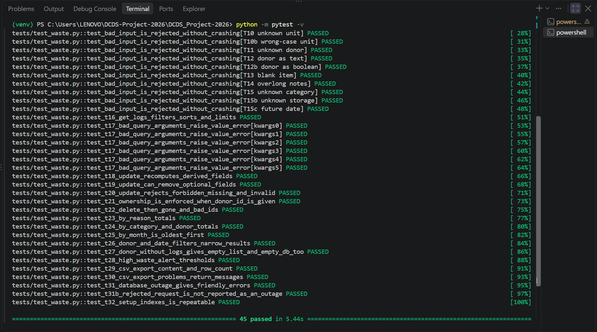
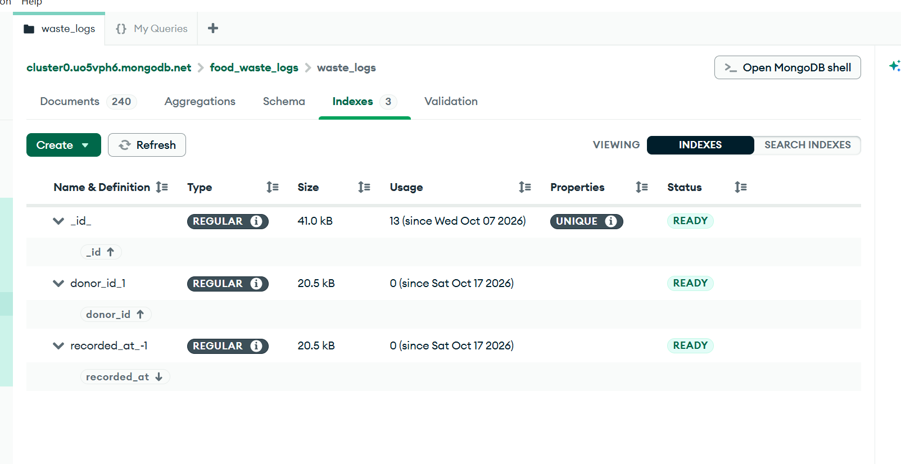
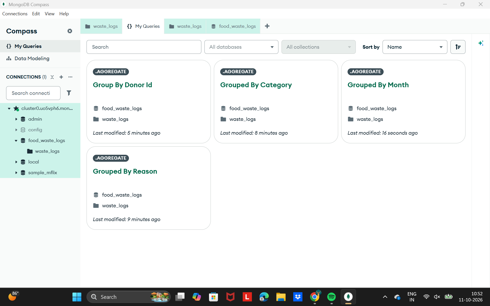
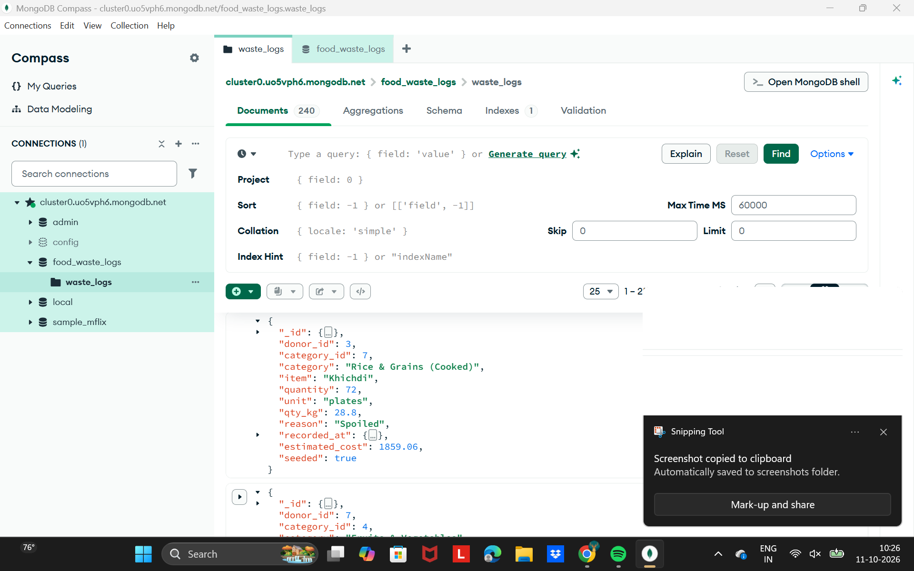

# DCDS_Project-2026

## MongoDB Waste Monitoring Module (`modules/waste.py`)

### Purpose and why MongoDB
Food waste events are logged continuously, differ in shape (some logs carry notes or a storage condition, others
do not) and are mostly analysed by aggregation. A document store fits this: no schema migrations for optional
fields, and the aggregation pipeline gives group-by reports. Donor identity stays in MySQL; each log stores
`donor_id` = `donors.donor_id` as the link between the two databases.

### Sample document
```json
{ "donor_id": 3, "category_id": 4, "category": "Fruits & Vegetables", "item": "Spinach",
  "quantity": 11.9, "unit": "kg", "qty_kg": 11.9, "reason": "Spoiled",
  "recorded_at": "2026-09-29T22:36:00Z", "estimated_cost": 388.37,
  "notes": "Optional", "storage_condition": "Cold (optional)", "seeded": true }
```
| Field | Type | Rule |
|---|---|---|
| donor_id | int | 1–8, matches MySQL donors |
| category_id / category | int / str | 1–8; name derived from id |
| item | str | 1–80 chars |
| quantity, unit | number, str | 0 < qty ≤ 5000; unit kg / plates / packets |
| qty_kg | number | derived (kg=1, plates=0.4, packets=0.25) |
| reason | str | Expired, Overproduction, Spoiled, Plate Waste, Unsold |
| recorded_at | datetime | real date, not text; defaults to now (UTC) |
| estimated_cost | number | derived from kg × category cost per kg |
| notes, storage_condition | optional | notes ≤ 200 chars; Hot / Cold / Ambient |
| seeded | bool | marks sample data |

### Aggregation pipelines
`$match` (donor/date filter) always comes first so the index is used, then:
* **waste_by_reason / waste_by_category** – `$group` on the field, `$sum` of qty_kg, `$sum:1` count, `$sort` by total, `$round` 2 decimals.
* **waste_by_month** – `$group` on `$dateToString` `%Y-%m`, sorted ascending for trend charts.
* **waste_totals_by_donor** – `$group` on donor_id.
* **high_waste_donors** – same grouping followed by a `$match` on `total_kg` (works like SQL HAVING); default threshold 400 kg.

### Validation, security, errors
All input is validated before touching the database: types (booleans and NaN/inf rejected), ranges, whitelisted
reason/unit/storage, trimmed text, valid ObjectId, derived fields recomputed on update, only whitelisted fields
editable, and donors can only update/delete their own logs. Queries use parameters, never string-built filters.
Connection failures give a friendly message instead of a stack trace.

### How to run
```
python -m pip install -r requirements.txt pytest
python -m seed.seed_waste          # 240 sample logs
python -m seed.create_indexes      # indexes on donor_id and recorded_at
python -m pytest -v                # tests use the waste_logs_test collection
```

### Expected results on the seed data
| Check | Expected |
|---|---|
| Documents | 240 |
| Expired | 86 logs, 805.8 kg |
| Months | 2026-06 … 2026-09 (4 rows) |
| Top donors | donor 5: 593.65 kg (60 logs); donor 3: 505.7 kg (46 logs) |
| High-waste alert (400 kg) | donors 5 and 3 |

### Test cases (fill Actual/Status after running on your machine)
| ID | Test | Expected | Actual | Status |
|---|---|---|---|---|
| T01–T05 | Valid log saved; derived qty_kg/category/cost correct; optional fields | ok=True | Logs saved; kg, category name and cost calculated correctly; notes and storage condition stored when given | Pass |
| T06–T15 | Bad donor, category, item, quantity (0, negative, bool, NaN), unit, reason, notes | ok=False + message | Every bad input was rejected with a clear message; nothing was written and nothing crashed | Pass |
| T16 | Filters, sorting and limit in get_waste_logs | Correct rows | Filters by donor, reason, category and date returned the right rows, newest first, and the limit was respected | Pass |
| T17 | Bad query arguments | ValueError | All 6 invalid argument sets raised ValueError| Pass |
| T18-T22 | Update (derived fields recomputed, optional fields removed, forbidden/invalid fields), ownership, delete, bad ids | As specified | Updates recalculated kg and cost; forbidden fields were refused; another donor could not edit or delete; a deleted log was gone; bad ids gave messages | Pass |
| T23–T25 | Totals by reason, by category and donor, by month vs hand-calculated 59.5 kg fixture | exact Totals | 	Totals matched the hand calculation; months came out oldest first | Pass |
| T26–T27 | Donor and date filters; donor with no logs; empty database | Narrowed results / empty list | Filters narrowed correctly; empty cases returned an empty list instead of an error | Pass |
| T28 | High-waste threshold | Only donors >= Threshold | Only donors at or above the threshold were flagged | Pass |
| T29-T30 | CSV export content and row count; export problems | File / messages | The CSV had the right columns and row count; a bad path returned a message | Pass |
| T31,T31b | Database unavailable / rejected request | Friendly message | An outage gave “Could not reach the waste database…”; a rejected request wasn’t reported as an outage | Pass |
| T32 | setup_indexes repeatable | Indexes exist | It ran twice without error; the indexes exist | Pass |







### Known limitations
Donor ids are fixed at 1–8 (no live cross-database check); seed dates are fixed Jun–Sep 2026; no DB-level
JSON-schema validation (validation is in Python).
